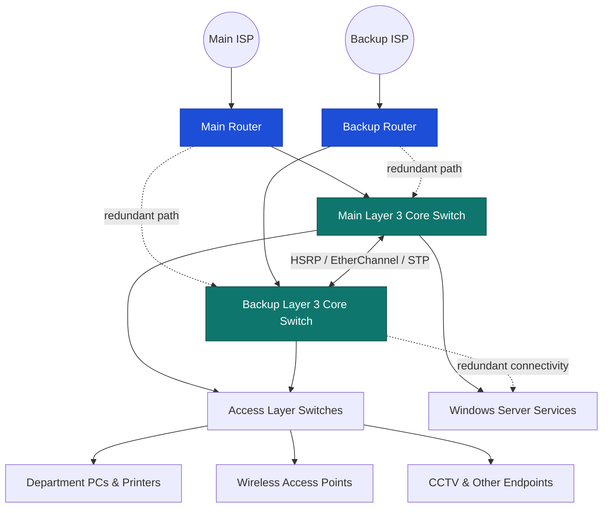

# 🌐 Ceylon Head Office | Enterprise Network Design & Implementation

**A case-study network infrastructure project focused on reliability, security, scalability, and efficient connectivity for Ceylon's head office.**

**[Overview](#-project-overview) • [Architecture](#-network-architecture) • [Technologies](#-technologies--protocols) • [Implementation](#-implementation-highlights) • [Verification](#-verification--results) • [Team](#-project-team)**

---

## 📖 Project Overview

This project presents the **design and implementation of an enterprise network for Ceylon (Pvt) Limited's head office**, developed as part of the **Diploma in Network Engineering (22.1F)** at the **National Institute of Business Management (NIBM), School of Computing**, in **2023**.

The proposed network uses a Cisco-oriented hierarchical architecture, redundant Layer 3 core switches, department-based VLANs, controlled routing and access, and Windows Server infrastructure. The project report covers both **logical and physical network design**, device configuration, and verification.

> [!NOTE]
> This is an **academic network design case study**. The report includes an illustrative company introduction; the repository should not be interpreted as documentation of a production deployment.

## 🎯 Objectives

- **Availability:** Design redundant paths and gateway failover to reduce disruption.
- **Security:** Segment departments and apply device-management and traffic-access controls.
- **Scalability:** Support additional users, departments, and network services.
- **Performance:** Improve traffic organization and aggregate switch links.
- **Manageability:** Document IP addressing, switch ports, equipment layouts, and verification steps.
- **Business continuity:** Plan for resilience and recovery from network faults.

## 🏗️ Network Architecture

The report describes a **collapsed hierarchical design** with a main and backup multilayer switch, access switches across the building, and main/backup edge connectivity.

*Simplified conceptual diagram based on the project report; consult its detailed topology and port tables for exact connections.*

### Physical design

The design documentation includes:

- Ground, first, second, and third-floor plans.
- Wireless access-point placement and floor-by-floor coverage heat maps.
- Rack and cabinet diagrams.
- Switch-to-device port assignments, cable planning, and bandwidth calculations.

## 🧰 Technologies & Protocols

| Area | Technologies | Purpose |
| --- | --- | --- |
| Segmentation | **VLANs, VLAN trunking, VTP** | Separate departments and distribute VLAN information |
| High availability | **HSRP, STP, EtherChannel** | Gateway redundancy, loop prevention, link aggregation |
| Routing | **Inter-VLAN routing, EIGRP** | Route traffic between internal networks and routers |
| Internet access | **NAT, PAT** | Translate internal addresses for external connectivity |
| Security & management | **ACLs, port security, SSH** | Traffic restrictions, switch-port controls, secure administration |
| Network services | **DHCP, DNS** | Automatic addressing and name resolution |
| Identity services | **Active Directory Domain Services (AD DS)** | Windows domain management |
| Server platform | **Windows Server 2016, VMware** | Virtualized server installation and role configuration |

## 🧩 VLAN & IP Addressing Examples

Selected examples from the report's IP addressing plan:

| Department / Usage | VLAN | Network |
| --- | ---: | --- |
| Wireless users | 100 | `172.16.0.0/24` |
| IT department | 40 | `172.16.1.0/25` |
| Training | 20 | `172.16.1.128/26` |
| CCTV & printers | 55 | `172.16.1.192/26` |
| Finance | 30 | `172.16.2.0/26` |
| HR | 31 | `172.16.2.64/26` |
| Call centre | 13 | `172.16.3.0/27` |

> [!IMPORTANT]
> These are **documented design values**, not a validated deployment configuration. Review the full addressing table and check subnet sizing, VLAN consistency, and device compatibility before reuse.

## ⚙️ Implementation Highlights

<b>🔀 Layer 3 core switching</b>

The report documents main and backup multilayer-switch configuration for VLAN interfaces, VLAN trunking, VTP, SSH, STP, EtherChannel, HSRP, IP routing, and selected security features.

<b>🖧 Layer 2 access switching</b>

Access-switch configuration covers hostnames, SSH, trunks, VLAN-to-port assignments, VTP, and port security. The design also documents port allocations for user devices and wireless access points.

<b>🌍 Edge router configuration</b>

Router configuration covers interface addressing, EIGRP, NAT, PAT, ACLs, and administrative security.

<b>🪟 Windows Server infrastructure</b>

The server section documents a Windows Server 2016 virtual-machine setup, installation of DHCP, DNS, and AD DS roles, domain-controller configuration, and DHCP scopes.

## 🧪 Verification & Results

The project report includes configuration screenshots and verification evidence for:

- **Core switches:** running configurations, SSH, VLANs, VTP, HSRP, EtherChannel, and routing.
- **Access switches:** VTP, access VLANs, ports, and port security.
- **Routers:** SSH and routing checks.
- **Connectivity:** ping tests and internet-connection verification.
- **Windows Server:** DHCP service configuration and verification.

The report describes successful network configuration and connectivity checks. **No independent performance benchmark or production uptime measurement is claimed here.**

## 📚 Project Documentation

The original report contains detailed network diagrams, IP addressing tables, device-port assignments, floor plans, Wi-Fi heat maps, rack diagrams, configuration screenshots, verification output, and device specifications.

**Report:** `DNE221F Final Project Report.pdf` — add the report to this repository if you want visitors to access it directly.

<b>📑 Report chapter guide</b>

1. **Introduction** — Ceylon head-office case study
2. **Background** — network goals and business requirements
3. **Design of Solution** — logical and physical topology, addressing, floor plans, and expenditure
4. **Implementation** — Layer 2/3 switch, router, and Windows Server configurations
5. **Results and Evaluation** — device verification and connectivity checks
6. **Conclusion** — project outcomes and future-focused network design

## 🚀 How to Explore This Project

1. Start with the **network architecture** diagram above.
2. Review the **VLAN and IP addressing** examples.
3. Read the report's **Design of Solution** chapter for floor plans, full addressing, and physical topology.
4. Read **Implementation** for device and server configuration screenshots.
5. Read **Results and Evaluation** for verification evidence.

> [!TIP]
> If you add topology images, lab files, or configuration exports to this repository later, link them here so visitors can inspect or reproduce the lab. Do not publish passwords, private keys, or other secrets from configuration exports.

## 👥 Project Team

| Member | Contribution |
| --- | --- |
| **D. T. P. Ladduwahetti** | Project team member |
| **B. A. S. Geethma** | Project team member |

**Academic supervisor:** Mr. Ilham Rasif  
**Institution:** National Institute of Business Management (NIBM) — School of Computing  
**Program:** Diploma in Network Engineering, Batch 22.1F  
**Year:** 2023

## 📄 License & Usage

This repository documents an academic project. **No software license is specified in the source report.** If you plan to distribute reusable configurations, diagrams, or code, add an appropriate `LICENSE` file and confirm you have permission to share any third-party material.

---

### ✨ Building secure, resilient, and scalable networks

Academic networking project • NIBM • 2023

